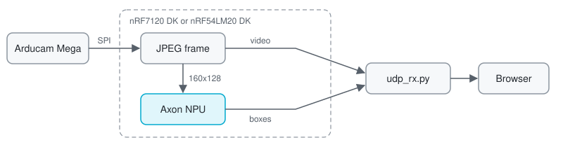
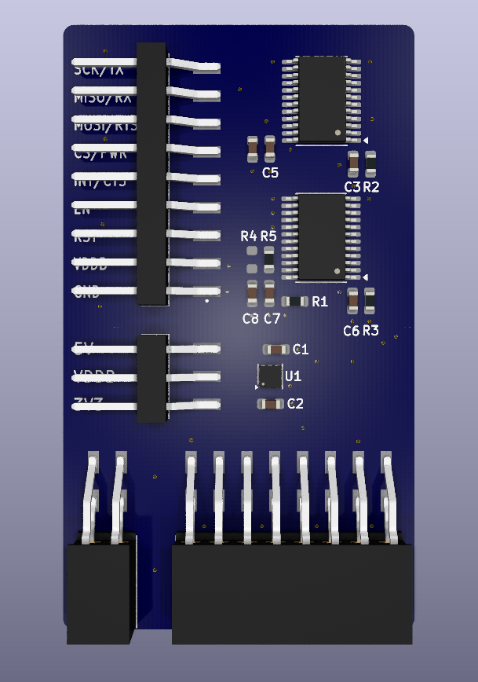

# Person detection video stream

Finds people in a live camera feed on the Axon NPU, and streams the video and the detections to your browser.

> [!WARNING]
> The stream is plain, unauthenticated UDP, to stay compatible with the existing receiver. Anyone on the path can watch it. Use it for demos only.

## How it works



- **Video:** the camera's JPEG frames, sent untouched.
- **Boxes:** sent as separate packets, tagged with the frame ID they belong to. They are not drawn into the video. The receiver draws them on top in the browser.

## Setup

Install the v3.5.0-preview3 toolchain as in [Set up the repository and toolchain](../../getting-started/setup.md). Then set up the workspace from this branch, and add nRF7120E support with `west patch apply`:

```shell
nrfutil sdk-manager toolchain launch --ncs-version v3.5.0-preview3 --shell
west init -m <repository URL> --mr <branch> smha-workspace
cd smha-workspace/project
west update
west patch apply
```

Open your setup, wire it, and build from `applications/person_detection_stream`:

<details markdown="1">
<summary><strong>Wi-Fi: nRF7120 DK</strong></summary>

**Hardware:** nRF7120 DK and Arducam Mega. Video is 640x480.

| Arducam Mega | nRF7120 DK |
| --- | --- |
| SCK | P1.12 |
| MISO | P1.13 |
| MOSI | P1.14 |
| CS | P1.15 |
| VCC | 3.3 V |
| GND | GND |

The camera runs at 3.3 V or 5 V, and the DK at 1.8 V. Connect them through a 1.8 V to 3.3 V level shifter, for example one built around an SN74LVC8T245. SCK, MOSI and CS go to the camera and MISO comes back. Power the camera from the 3.3 V side. 5 V is untested. This is ours:



```shell
west build -p -b nrf7120dk/nrf7120e/cpuapp
west flash
```

Run the receiver on a computer on the same network, for example a phone hotspot.

</details>

<details markdown="1">
<summary><strong>Wi-Fi + LTE: nRF7120 DK and nRF93M1 DK</strong></summary>

**Hardware:** nRF7120 DK, Arducam Mega and nRF93M1 DK. Video is 640x480 on Wi-Fi and 320x240 on LTE.

| Arducam Mega | nRF7120 DK |
| --- | --- |
| SCK | P1.12 |
| MISO | P1.13 |
| MOSI | P1.14 |
| CS | P1.15 |
| VCC | 3.3 V |
| GND | GND |

The camera runs at 3.3 V or 5 V, and the DK at 1.8 V. Connect them through a 1.8 V to 3.3 V level shifter, for example one built around an SN74LVC8T245. SCK, MOSI and CS go to the camera and MISO comes back. Power the camera from the 3.3 V side. 5 V is untested. This is ours:


| nRF93M1 DK | nRF7120 DK |
| --- | --- |
| TX | P2.10 |
| RX | P2.07 |
| RTS | P2.08 |
| CTS | P2.11 |
| PKEY | P0.10 |
| RST | P0.06 |
| GND | GND |

- **nRF93M1 DK:** flash it with modem bypass. Set the modem to 3 Mbaud once with `AT+IPR=3000000` from a terminal on its VCOM1, which it keeps. Then disable VCOM1 in Board Configurator.
- **nRF7120 DK:** route P2.06–P2.11 to the P2 header in Board Configurator. The modem lines are 1.8 V and connect directly.

```shell
west build -p -b nrf7120dk/nrf7120e/cpuapp -- \
  -DEXTRA_CONF_FILE=overlay-lte-nrf7120dk.conf \
  -DEXTRA_DTC_OVERLAY_FILE=overlay-lte-nrf7120dk.overlay
west flash
```

On Wi-Fi, run the receiver on a computer on the same network. Over LTE the device sits behind the operator's NAT, so the receiver needs a public IP with UDP port 5005 open.

</details>

<details markdown="1">
<summary><strong>LTE: nRF54LM20 DK and nRF93M1 DK</strong></summary>

**Hardware:** nRF54LM20 DK, Arducam Mega and nRF93M1 DK. Video is 320x240.

| Arducam Mega | nRF54LM20 DK |
| --- | --- |
| SCK | P1.04 |
| MISO | P1.05 |
| MOSI | P1.06 |
| CS | P1.07 |
| VCC | 3.3 V |
| GND | GND |

The nRF93M1 only works at 1.8 V, so set the DK's IO to 1.8 V in Board Configurator. The camera runs at 3.3 V or 5 V. Connect them through a 1.8 V to 3.3 V level shifter, for example one built around an SN74LVC8T245. SCK, MOSI and CS go to the camera and MISO comes back. Power the camera from the 3.3 V side. 5 V is untested. This is ours:


| nRF93M1 DK | nRF54LM20 DK |
| --- | --- |
| TX | P2.07 |
| RX | P2.08 |
| RTS | P2.09 |
| CTS | P2.10 |
| PKEY | P1.11 |
| RST | P1.10 |
| GND | GND |

- **nRF93M1 DK:** flash it with modem bypass. Set the modem to 3 Mbaud once with `AT+IPR=3000000` from a terminal on its VCOM1, which it keeps. Then disable VCOM1 in Board Configurator.
- **nRF54LM20 DK:** at 1.8 V IO, the modem lines connect directly.

```shell
west build -p -b nrf54lm20dk/nrf54lm20b/cpuapp
west flash
```

The device sits behind the operator's NAT, so the receiver needs a public IP with UDP port 5005 open.

</details>

## Run

This receiver is for private testing outside thingy.rocks. Host it on a machine the device can reach:

```shell
python3 -m pip install pillow
python3 tools/udp_rx.py
```

It takes the stream on UDP port 5005 (`--port`) and serves the viewer over HTTP on port 8080 (`--http-port`). Open the viewer in a browser at the address where you host it.

Point the DK at it in the shell. The settings are stored, and the Wi-Fi lines are only needed on the nRF7120 DK:

```text
uart:~$ wifi cred add -s "<SSID>" -k 1 -p "<passphrase>"
uart:~$ wifi cred auto_connect
uart:~$ stream endpoint <receiver address> 5005
```

## Shell

| Command | Action |
| --- | --- |
| `detect confidence <0-100>` | Lowest confidence a box needs. |
| `detect fps <1-30>\|max` | Limit how often detection runs. |
| `stream video\|ai-input` | Stream the camera, or the 160x128 image the model sees. |
| `camera profile auto\|low` | `auto` uses large frames on Wi-Fi and small ones on LTE. |
| `network use auto\|wifi\|lte` | Choose the network. The stream moves once the new one is up. |
| `network status` | Show the networks and the one in use. |

## Known issues

- **Wi-Fi interference:** streaming 640x480 over Wi-Fi interferes with the camera, so some frames arrive corrupt. The browser view recovers on its own.
